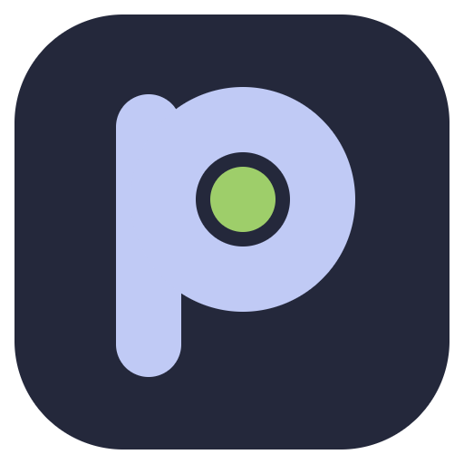
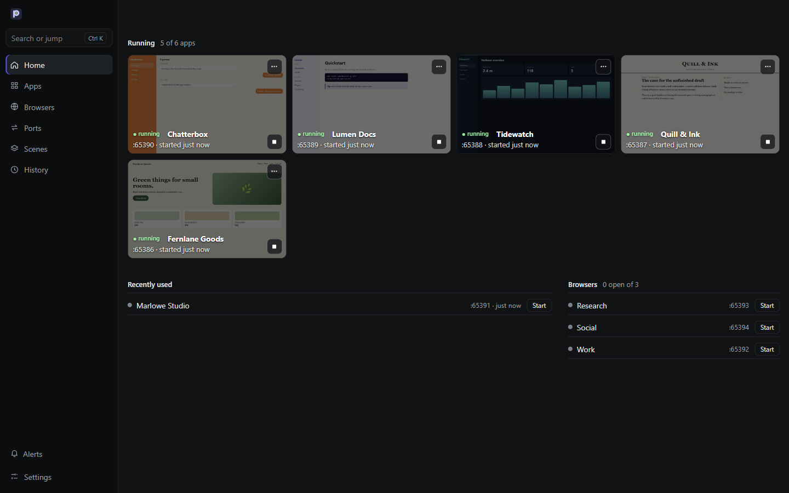
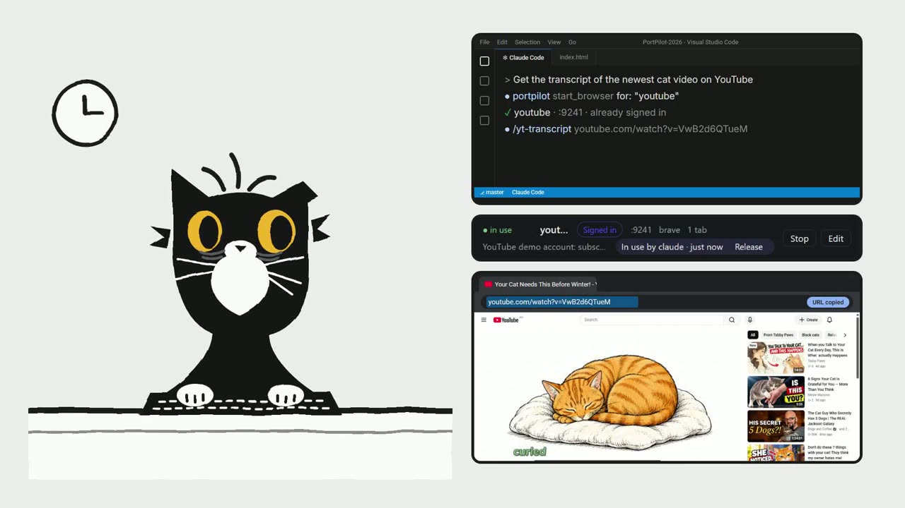
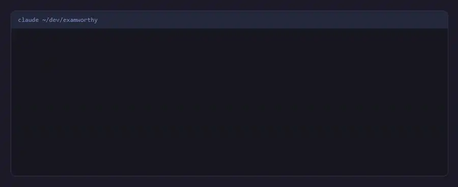
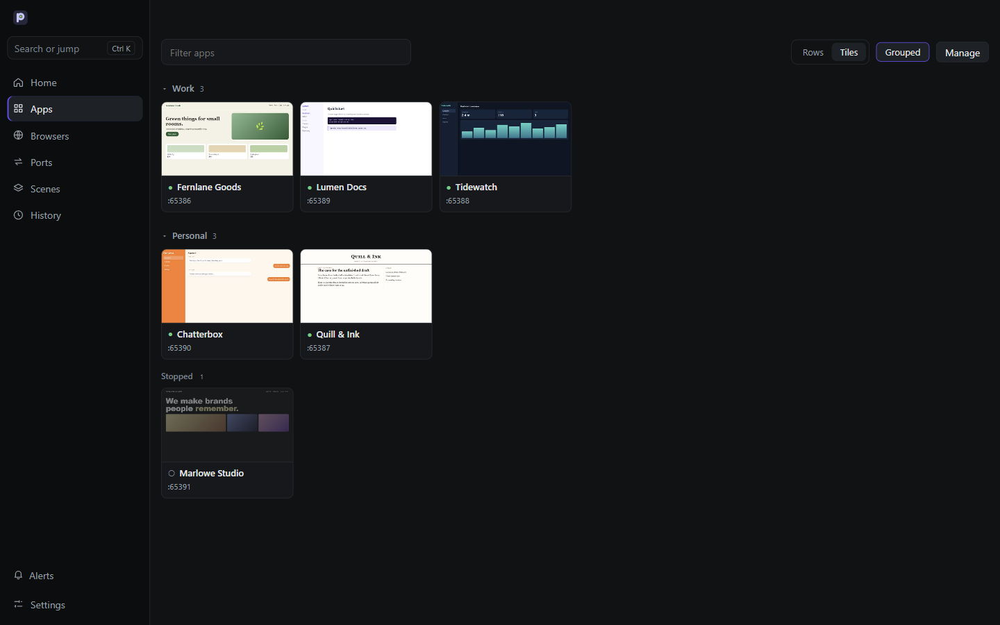
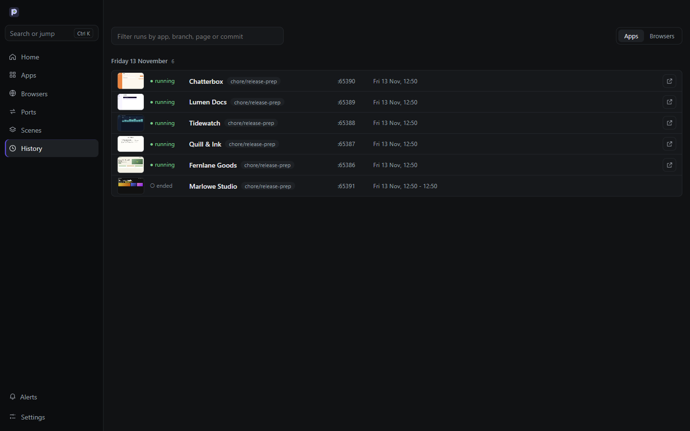
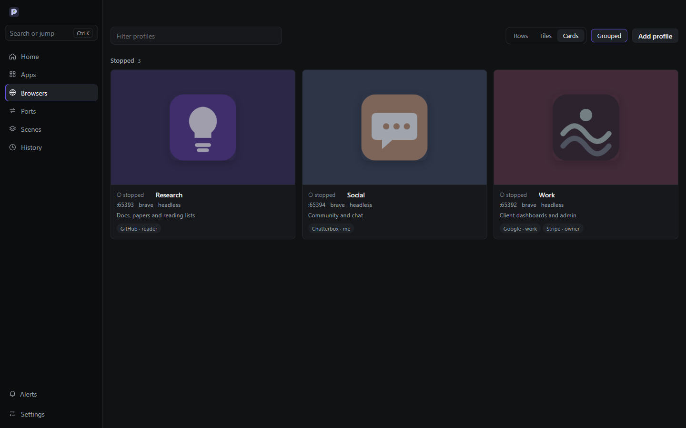
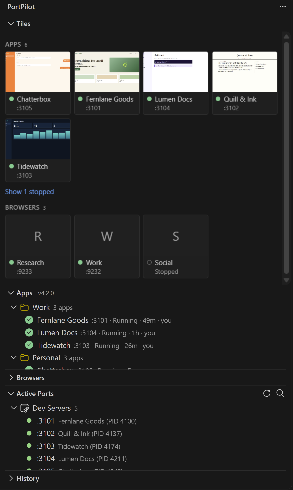

<div align="center">



# PortPilot

### Every localhost app and dedicated browser on your machine, and who started it.

PortPilot shows the sites you are running locally, each with its port, a live preview of the page and any crash.

It gives every job its own signed-in browser on a debug port.

Connect an AI assistant (Claude Code, Cursor, Windsurf, Cline or any MCP client) and it sees the same apps and browsers you do.

The assistant reuses a running server instead of starting a second copy, and takes the browser that matches the site it needs.

It works on its own; the assistant link is optional.

Prefer to stay in your editor? The same apps, ports and crash alerts are in the [PortPilot VS Code extension](https://marketplace.visualstudio.com/items?itemName=macdara.portpilot).

[](https://github.com/m4cd4r4/PortPilot/releases/tag/v5.0.1)
[](tests/)
[](LICENSE)
[](docs/REFERENCE.md#mcp-tools-26)
[](https://marketplace.visualstudio.com/items?itemName=macdara.portpilot)

**[Download](#install)** &nbsp;&middot;&nbsp; **[Connect an AI assistant](#use-it-with-claude-code)** &nbsp;&middot;&nbsp; **[Dedicated browsers](#dedicated-browsers)** &nbsp;&middot;&nbsp; **[VS Code extension](https://marketplace.visualstudio.com/items?itemName=macdara.portpilot)** &nbsp;&middot;&nbsp; **[A tour of the app](#a-tour-of-the-app)** &nbsp;&middot;&nbsp; **[Website](https://m4cd4r4.github.io/PortPilot/)**

</div>



[](docs/media/browsers-film.mp4)

*One sentence, and the browser is already signed in.*

*Claude asks for the `youtube` profile, PortPilot opens it on :9241 with the account signed in, and the assistant reads the newest video on the subscriptions feed.*

*18 seconds, silent; the demo uses a throwaway channel. [Play the film](docs/media/browsers-film.mp4) or [watch it on the site](https://m4cd4r4.github.io/PortPilot/#browsers).*

https://github.com/user-attachments/assets/d7ecd1d4-462c-4108-a00f-8bf896cbe7a9

*The same apps in VS Code: hover one for a page preview and its buttons. [Get the extension](https://marketplace.visualstudio.com/items?itemName=macdara.portpilot).*

Local-first: no account, no telemetry, no cloud.

Windows 10/11 and Linux.

## Install

| Platform | Download |
|----------|----------|
| Windows installer | [PortPilot-5.0.1-x64.exe](https://github.com/m4cd4r4/PortPilot/releases/download/v5.0.1/PortPilot-5.0.1-x64.exe) (119 MB) |
| Windows portable | [PortPilot-5.0.1-portable.exe](https://github.com/m4cd4r4/PortPilot/releases/download/v5.0.1/PortPilot-5.0.1-portable.exe) (119 MB) |
| Linux AppImage | [PortPilot-5.0.1-x86_64.AppImage](https://github.com/m4cd4r4/PortPilot/releases/download/v5.0.1/PortPilot-5.0.1-x86_64.AppImage) (129 MB) |
| Debian / Ubuntu | [PortPilot-5.0.1-amd64.deb](https://github.com/m4cd4r4/PortPilot/releases/download/v5.0.1/PortPilot-5.0.1-amd64.deb) (91 MB) |

Install it, click Scan, then add your projects.

Older builds are on [Releases](https://github.com/m4cd4r4/PortPilot/releases).

macOS: build from source; it is supported but not officially tested.

```bash
git clone https://github.com/m4cd4r4/PortPilot.git
cd PortPilot
npm install
npm start
```

## What you get

**One place for every local server**
- Apps you registered, servers you started in a terminal and servers Claude started all show up.
- Each has its port, its state and a live preview of the page.
- Quitting PortPilot leaves your servers running; it picks them up again on the next launch.

**Named browsers with their own debug ports**
- One profile per purpose (Search Console, GitHub, a staging admin), each signed in once.
- A profile is handed to an assistant by task and shown as a tile next to your apps.
- More in [Dedicated browsers](#dedicated-browsers).

**Port trouble fixed in a click**
- Press Start on an app whose port is taken and PortPilot names what holds it, with a link to Ports filtered to that port.
- A crashed app keeps its exit code and last stderr line in History.

**A run record**
- Every run is kept with the git state it came from, so you can come back to it later.
- Each run says who started it: you, or the Claude session that did.

**Assistants that cooperate**
- Claude Code and other MCP clients start, stop and find servers through PortPilot.
- They are turned away from a second copy of a server that is already up.

## Dedicated browsers

A **debug port** is how a program drives a Chromium browser.

A PortPilot **browser profile** is a named browser with its own sign-ins and its own debug port.

A `google` profile stays signed in to Search Console while a `github` profile stays signed in to GitHub.

Nothing picks a port by chance: you give each profile one, and PortPilot hands that port to Claude.

**Claude asks by purpose**
- Label each profile with what it is for and the sites it logs into.
- Claude calls `start_browser` with `for` set to the site and gets the matching profile and its `cdpUrl`.
- A profile one session started is held for it until that session ends.
- A second session is told it is in use and steered to a free one.

**Start and Stop**
- Use the Browsers screen or the VS Code Browsers view.
- Start opens the profile's own Brave or Chrome on its port.
- Stop frees the port.

**A blocked port is reported, not worked around**
- If another program holds a profile's port, the row says which one.

Browser history, window placement, routing and lease rules: [reference](docs/REFERENCE.md#browser-profiles-in-detail).

## Use it with Claude Code

```text
/plugin marketplace add m4cd4r4/PortPilot
/plugin install portpilot@portpilot
```

The MCP server is bundled, so there is no `npm install`.

One install gives Claude:

- **Status line.** Every session shows what is up, worst state first. A ✦ marks apps Claude started.
  ```text
  ⚓ 1 crashed · 7 up · :3000 examworthy-web
  ```
- **Dev-server guard.**
  - A start on a busy port is turned away with the URL to reuse.
  - A clean start goes through PortPilot.
  - If the guard can't tell what a command does, it lets it run.
- **Crash band with Fix it.**
  - When an app Claude started crashes, the session gets a band with Restart, Logs and Fix it.
  - Fix it hands Claude the crash and the stderr tail.
- **The PortPilot tools**: list, start, stop, scan, kill, group, find a past run and manage browsers, as the 26 [MCP tools](docs/REFERENCE.md#mcp-tools-26).
- **A browser per purpose**, as above.



Other assistants (Claude Desktop, Cursor, Windsurf, Cline, any MCP client) use the same MCP server without the plugin.

Setup is in [mcp-server/README.md](mcp-server/README.md).

Ask in plain language: "What's running on :3000?", "Start statewise", "Kill whatever is on port 8000".

<details>
<summary><b>Make Claude use PortPilot by default</b></summary>

The plugin does most of this on its own:

- The dev-server guard routes starts through PortPilot.
- A skill tells Claude never to start a server with bare Bash.
- The start of every conversation lists your browser profiles.

The skill is the part Claude decides to load. For a firm default, add this to `~/.claude/CLAUDE.md` (all projects) or a project's `CLAUDE.md`:

```text
## Local servers and browsers: use PortPilot
- Start, stop and check dev servers with the PortPilot MCP tools (list_running, check_port, start_app, add_app), never a bare `npm run dev &` or `kill`. Reuse a running server.
- For any browser automation, call PortPilot `start_browser` with `for` set to the site or URL, and use the `cdpUrl` it returns. Never launch a browser with a debug port or choose a port yourself.
- On NO_MATCH or AMBIGUOUS, ask me; do not fall back to `name: "any"` for a task tied to a site.
- Never kill a port or delete an app unless I ask.
```

Then label each browser profile (what it is for, which sites it logs into), because Claude can only match what you wrote.

Other MCP assistants have no plugin, so put the same text in their instructions file.

</details>

More Claude Code screenshots (status line, crash band, `find_run`): [reference](docs/REFERENCE.md#more-claude-code-views).

## A tour of the app

<table>
  <tr>
    <th>Apps</th>
    <th>History</th>
    <th>Browsers</th>
  </tr>
  <tr>
    <td width="33%"><a href="docs/screenshots/ui/apps.png"></a></td>
    <td width="33%"><a href="docs/screenshots/ui/history.png"></a></td>
    <td width="33%"><a href="docs/screenshots/ui/browsers.png"></a></td>
  </tr>
</table>

**Home**
- Shows what you were just doing: a row per running app with Open, Stop and Details.
- Your browser profiles as pictures, and recently used apps with a thumbnail of the page each served.

**Apps**
- Every app as a card with a live preview of its page, running first and stopped ones below.
- Switch between Rows and Tiles, and between Grouped and Flat.
- A stopped app stays "stopped" even when another program holds its port; you are told when you press Start. The Alerts bell counts crashes and failed starts only.

**Manage**
- Turns the Apps screen into the editing table.
- Auto-detect finds Node.js, Python, Go, .NET, Rust, Ruby and Docker projects ([how detection works](docs/AUTO-DETECTION.md)).

**History**
- Every run is recorded with its state, port, time and the page it served. A crash reads `Crashed · exit 1`.
- Filter by app, branch, page or commit.
- Open a run that is still up, or start a past one again.
- Servers PortPilot did not start (from a terminal, Claude or an editor) are recorded too once they answer HTTP on two scans in a row; switch that off under Settings.

**Ports**
- Lists every TCP port with its process.
- Offers Kill and Find a free port.

**Scenes**
- Start a set of apps and profiles together.

**Settings**
- The theme, close-to-tray, crash notifications and run-history options.

**`Ctrl+K`**
- From anywhere, type an app, a port or a profile.
- Start it, stop it, open it or jump to its history.

## Other ways in

One config file and one run record sit behind every surface, so an app you add in one shows up in the others.

**VS Code extension** ([Marketplace](https://marketplace.visualstudio.com/items?itemName=macdara.portpilot))
- Picture tiles for your apps and browser profiles at the top of the sidebar.
- Then the tree, a status bar item and a crash toast, without leaving the editor.
- Running apps come first, stopped ones fold away, and a ✦ marks anything Claude started.



**Web portal** ([details](docs/REFERENCE.md#web-agent-preview))
- The classic Apps view in your browser, from `npm run agent`.
- It binds `127.0.0.1` only and needs a per-session token.
- The new screens, row previews and crash toasts are not in the portal yet.

**Tray**
- A tray menu with a Stop per running app keeps your servers alive after you close the window.

## More

Everything else (the 26 MCP tools, badges, keyboard shortcuts, config file, web agent, development and testing) is in the [reference](docs/REFERENCE.md).

What changed in each version: [CHANGELOG.md](CHANGELOG.md) and [GitHub Releases](https://github.com/m4cd4r4/PortPilot/releases).

## Contributing

Pull requests are welcome. Bugs and ideas: [open an issue](https://github.com/m4cd4r4/PortPilot/issues).

## Licence

MIT. See [LICENSE](LICENSE).
