<div align="center">

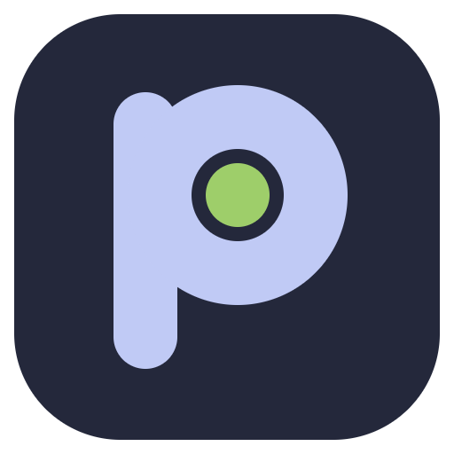

# PortPilot

**See every dev server on your machine, and who started it.**

PortPilot runs your local dev servers and shows every port, every crash and who started each one. Connect an AI assistant (Claude Code, Cursor, Windsurf, Cline or any MCP client) and it sees the same apps you do, and reuses a running server instead of starting a second copy. It works on its own; the assistant link is optional.

[](https://github.com/m4cd4r4/PortPilot/releases/tag/v5.0.0)
[](tests/)
[](LICENSE)
[](mcp-server/README.md)
[](https://marketplace.visualstudio.com/items?itemName=macdara.portpilot)

**[Download](#install)** &nbsp;&middot;&nbsp; **[Connect an AI assistant](#use-it-with-claude-code)** &nbsp;&middot;&nbsp; **[Website](https://m4cd4r4.github.io/PortPilot/)**

</div>

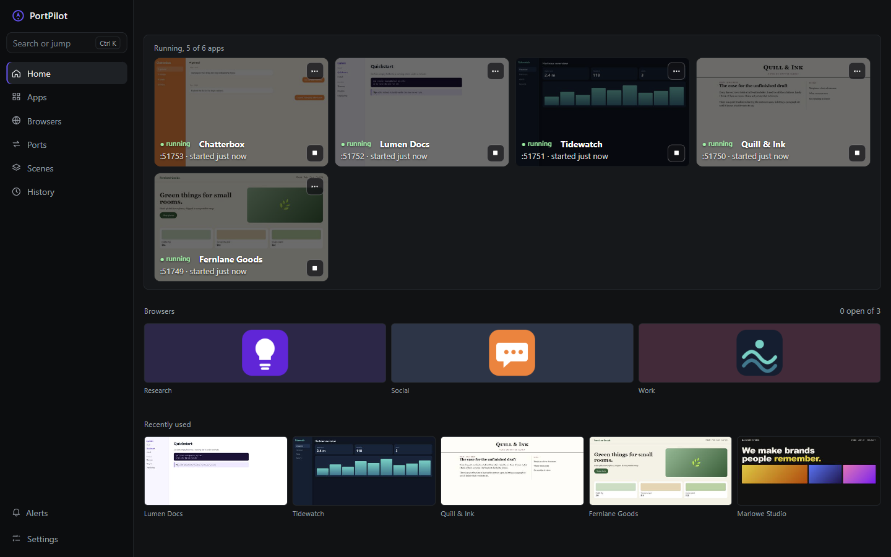

Local-first: no account, no telemetry, no cloud. Windows 10/11 and Linux.

## What you get

- **One place for every local server.** Apps you registered, servers you started in a terminal and servers Claude started all show up, with the port, the state and a live preview of the page.
- **Port trouble fixed in a click.** A blocked port is flagged on every screen; one button frees it. A crashed app keeps its exit code and last stderr line in History.
- **A run record.** Every run is kept with the git state it came from, so you can come back to it later.
- **Assistants that cooperate.** Claude Code and other MCP clients start, stop and find servers through PortPilot, and are turned away from a second copy of a server that is already up.
- **Named browsers with their own debug ports.** One profile per purpose (Search Console, GitHub, a staging admin), each signed in once, handed to an assistant by task.

## A tour of the app

### Home

The first screen shows what you were just doing: one row per running app with Open, Stop and Details, your browser profiles as pictures, and the apps you ran recently, each with a thumbnail of the page it served. With nothing running it offers the app you used last with Start. A crashed app in Recently used has a Start button. A blocked port shows as one amber line at the top with a Fix button. On a first run it says what to do instead of showing empty cards.

### Apps

Every app as a card with a live preview of its page, running first and stopped ones below. Switch between Rows and Cards, and between Grouped and Flat. An app another program is holding the port of is marked **Port held**.

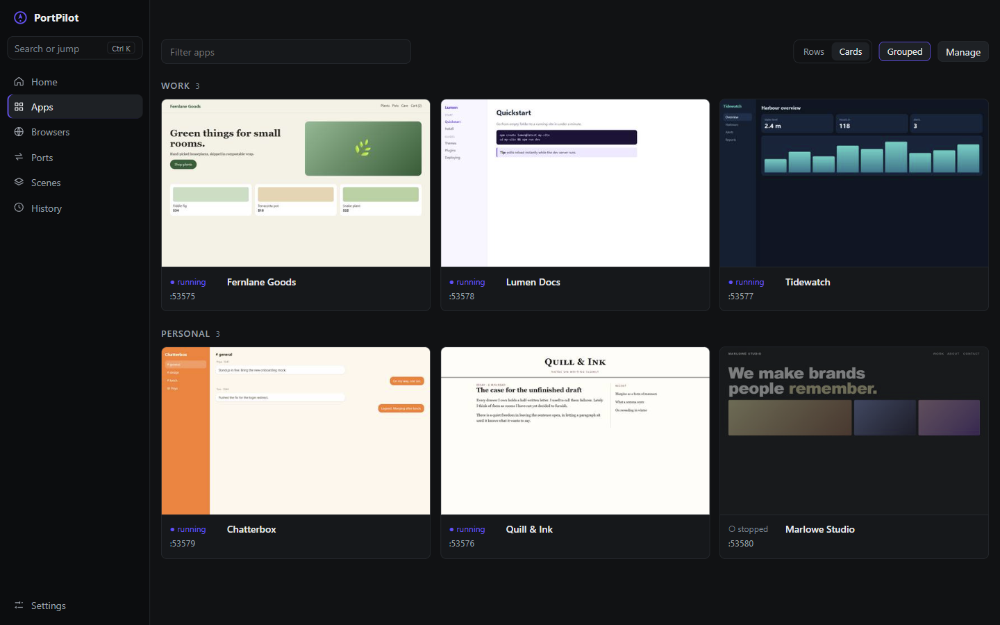

**Manage** turns the same screen into the editing table: Star, Start or Stop, Details and Edit per app, plus Groups, Add app and an auto-detect that finds Node.js, Python, Go, .NET, Rust, Ruby and Docker projects ([how detection works](docs/AUTO-DETECTION.md)).

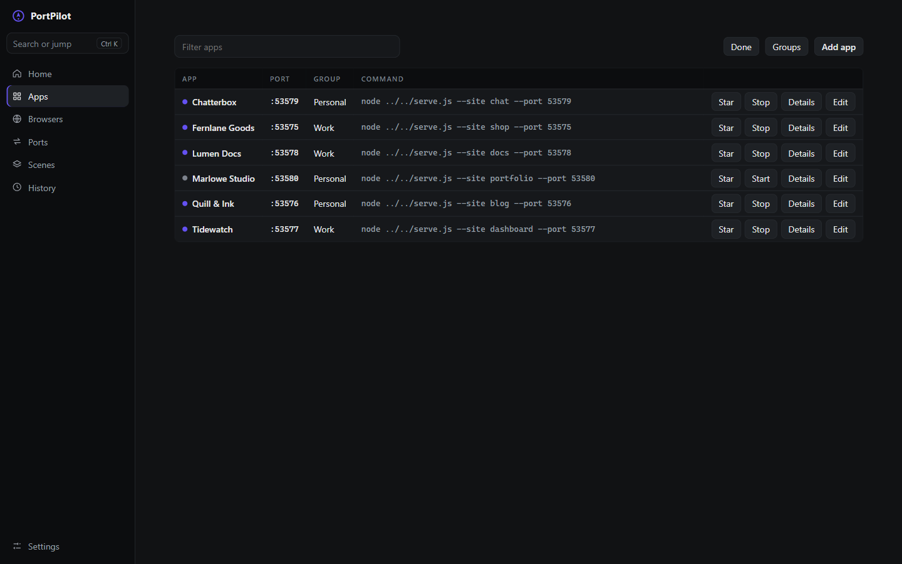

### History

Every run is recorded with its state, port, time and the page it served; a crash reads `Crashed · exit 1`. Filter by app, branch, page or commit, open a run that is still up, or start a past one again. Servers PortPilot did not start (from a terminal, Claude or an editor) are recorded too once they answer HTTP on two scans in a row; switch that off under Settings.

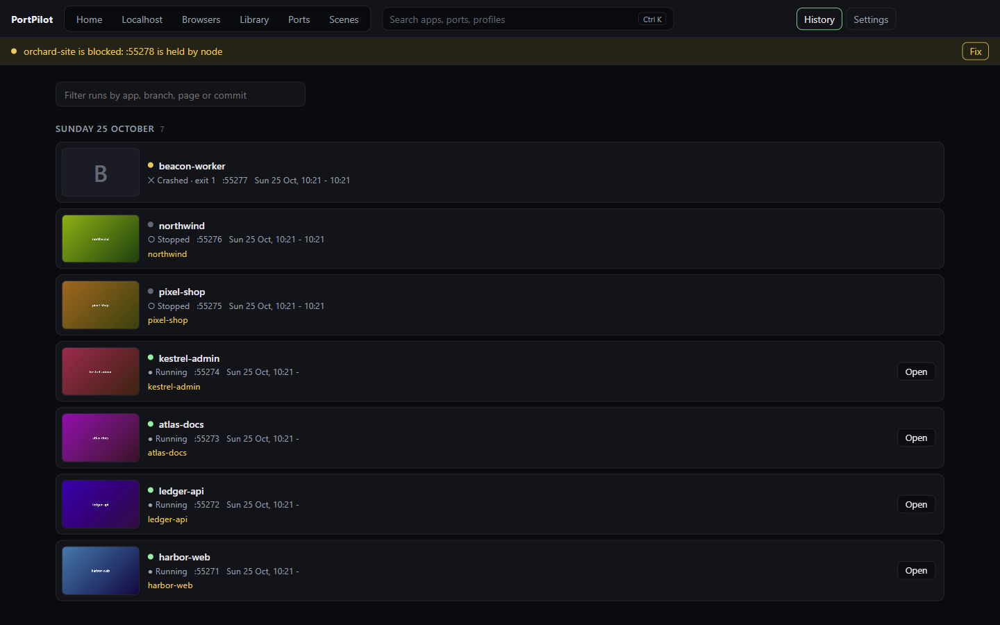

### Command palette

`Ctrl+K` from anywhere: type an app, a port or a profile and start it, stop it, open it or jump to its history.

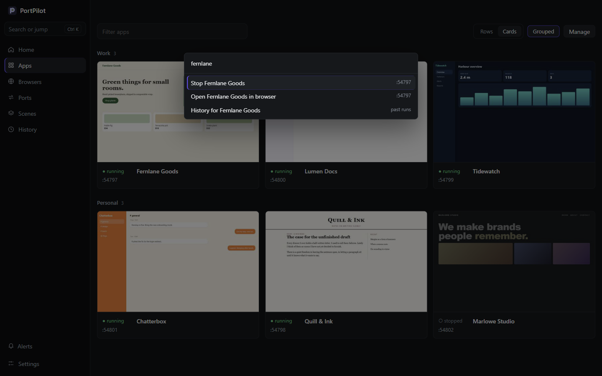

### Browsers

Named browser profiles with a purpose, the sites each is signed in to and its own debug port. **Set up sign-ins** opens Brave's own Sync or Import passwords page in the profile, so you sign in once and PortPilot never reads a saved password. See [Browsers and debug ports](#browsers-and-debug-ports).

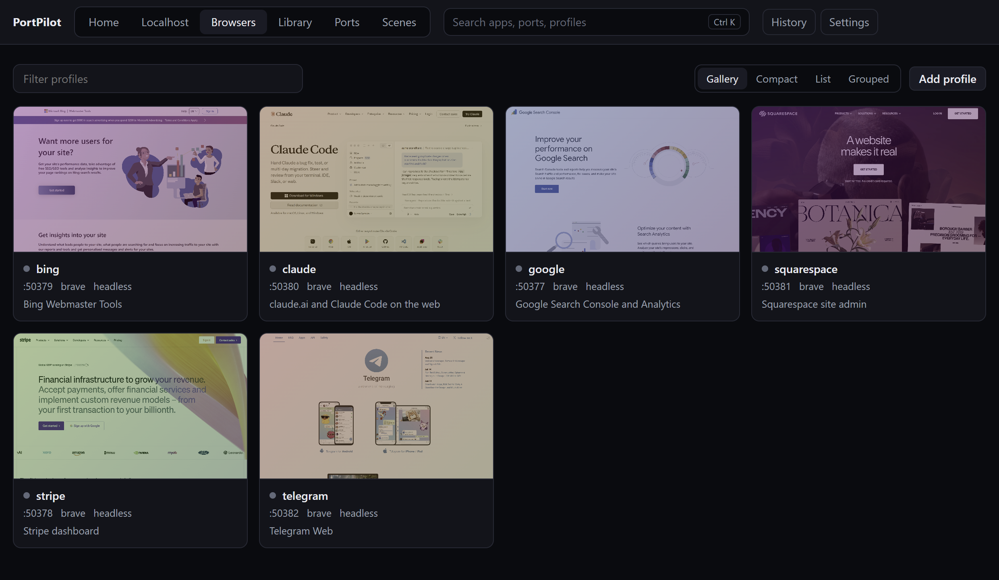

### Ports, Scenes and Settings

**Ports** lists every TCP port with its process and PID and offers Kill, Open and Find a free port. **Scenes** (under More) are sets of apps and browser profiles you start together ("Morning work": three apps and the Google profile); Stop only stops what the scene started, and **Save what is running** turns the current state into a scene. **Settings** has the theme (Dark, Light or System), close-to-tray, crash notifications and the run-history options. The old interface is one click away under Settings > Switch to classic view.

## Use it with Claude Code

```text
/plugin marketplace add m4cd4r4/PortPilot
/plugin install portpilot@portpilot
```

The MCP server is bundled, so there is no `npm install`. One install gives Claude:

- **Status line.** Every session shows what is up, worst state first. A ✦ marks apps Claude started.
  ```text
  ⚓ 1 crashed · 7 up · :3000 examworthy-web
  ```
- **Dev-server guard.** A start on a busy port is turned away with the URL to reuse. A clean start goes through PortPilot. If the guard can't tell what a command does, it lets it run.
- **Crash band with Fix it.** When an app Claude started crashes, the session gets a band with Restart, Logs and Fix it. Fix it hands Claude the crash and the stderr tail.
- **The PortPilot tools**: list, start, stop, scan, kill and group, as the 26 [MCP tools](#mcp-tools).
- **A browser per purpose.** You say what each profile is for (`Google Search Console, Analytics`) and which sites it logs into (`search.google.com`). Ask Claude to "access Google Search Console" and PortPilot hands it the right profile and port (`start_browser` with `for`); it refuses to guess when two profiles fit, and says so when none does.
- **Browsers that do not collide.** Several sessions can each have a named browser profile with its own debug port. A profile one session started is leased to it while that session is alive: a second session is told `IN_USE` and is steered to a free profile, unless it passes `takeover:true` after telling you.

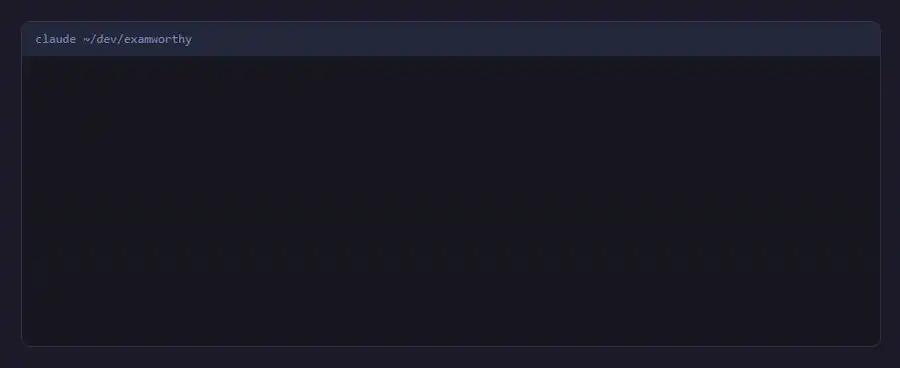

<details>
<summary><b>More Claude Code views</b></summary>

Status line, worst state first, ✦ on apps Claude started:

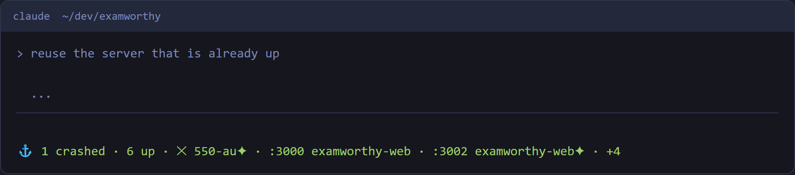

Crash band with Fix it, Restart, Logs and Dismiss:

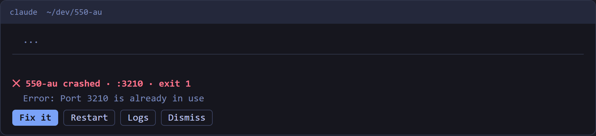

`find_run` bringing back a past version of a page, with the literal steps:

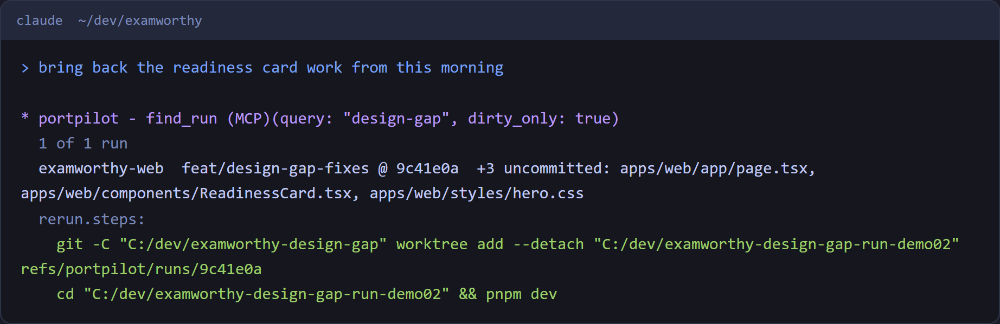

The Claude Code images are terminal frames rendered around the plugin's real output on the demo data, not captures of the Claude Code app.

</details>

### Any MCP assistant

The PortPilot MCP server works with Claude Code, Claude Desktop, Cursor, Windsurf, Cline and any other MCP client. Ask in plain language:

```text
"What's running on :3000?"
"Start statewise"
"Kill whatever is on port 8000"
"Start all my favourites"
```

Setup outside the plugin: [mcp-server/README.md](mcp-server/README.md).

### Make Claude use PortPilot by default

The plugin does most of this on its own: the dev-server guard routes starts through PortPilot, a skill tells Claude never to start a server with bare Bash, and the start of every conversation lists your browser profiles. The skill is the part Claude decides to load, so for a firm default add this to `~/.claude/CLAUDE.md` (all projects) or a project's `CLAUDE.md`:

```text
## Local servers and browsers: use PortPilot
- Start, stop and check dev servers with the PortPilot MCP tools (list_running, check_port, start_app, add_app), never a bare `npm run dev &` or `kill`. Reuse a running server.
- For any browser automation, call PortPilot `start_browser` with `for` set to the site or URL, and use the `cdpUrl` it returns. Never launch a browser with a debug port or choose a port yourself.
- On NO_MATCH or AMBIGUOUS, ask me; do not fall back to `name: "any"` for a task tied to a site.
- Never kill a port or delete an app unless I ask.
```

Then label each browser profile (what it is for, which sites it logs into), because Claude can only match what you wrote. Other MCP assistants have no plugin, so put the same text in their instructions file.

## Browsers and debug ports

A **debug port** is how a program drives a Chromium browser. The browser opens with `--remote-debugging-port=<n>`, and anything that can reach `127.0.0.1:<n>` can then read its tabs and click in them. A **browser profile** in PortPilot is a named browser with its own sign-ins and its own debug port, so a `google` profile stays signed in to Search Console while a `github` profile stays signed in to GitHub. Nothing picks a port by chance: you give each profile one, and PortPilot hands that port to Claude.

- **Start and Stop.** In the Browsers screen, or in the VS Code Browsers view, Start opens the profile's own Brave or Chrome on its port and Stop closes it and frees the port.

  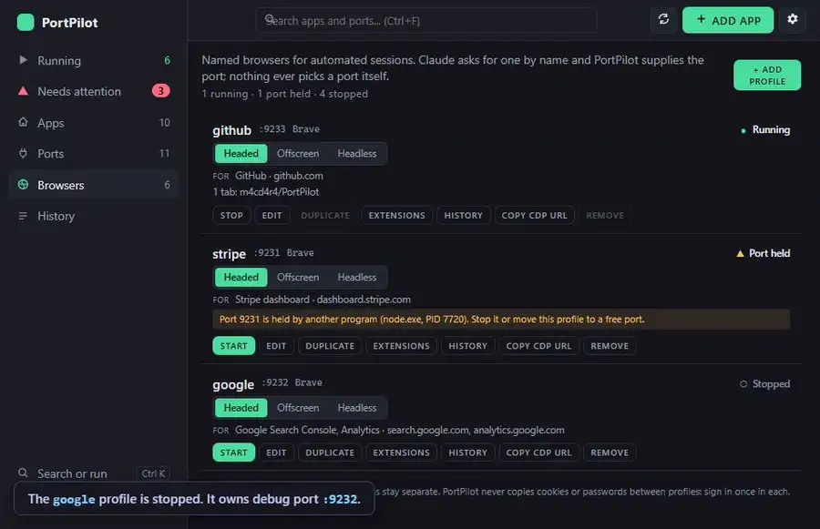

- **Claude asks by purpose.** Label each profile with what it is for and the sites it logs into. Claude calls `start_browser` with `for` set to the site, gets the matching profile and its `cdpUrl`, and a session that started a profile holds it until the session ends.

  

- **A blocked port is reported, not worked around.** If another program holds a profile's port, the row says which one.
- **Browser history.** Each profile's past sessions: who started and stopped each, when, and the pages that were open, with secrets in addresses hidden. **Open again** starts the profile and opens those pages (http and https only, at most 20).

The Claude Code clips on this page are terminal frames rendered around the plugin's real output, not captures of the Claude Code app.

## Other ways in

One config file and one run record sit behind every surface, so an app you add in one shows up in the others.

- **VS Code extension.** The sidebar tree, a status bar item and a crash toast, without leaving the editor. Running apps come first, stopped ones fold away, and a ✦ marks anything Claude started. A Browsers view lists your profiles with Start and Stop. [Marketplace](https://marketplace.visualstudio.com/items?itemName=macdara.portpilot).

  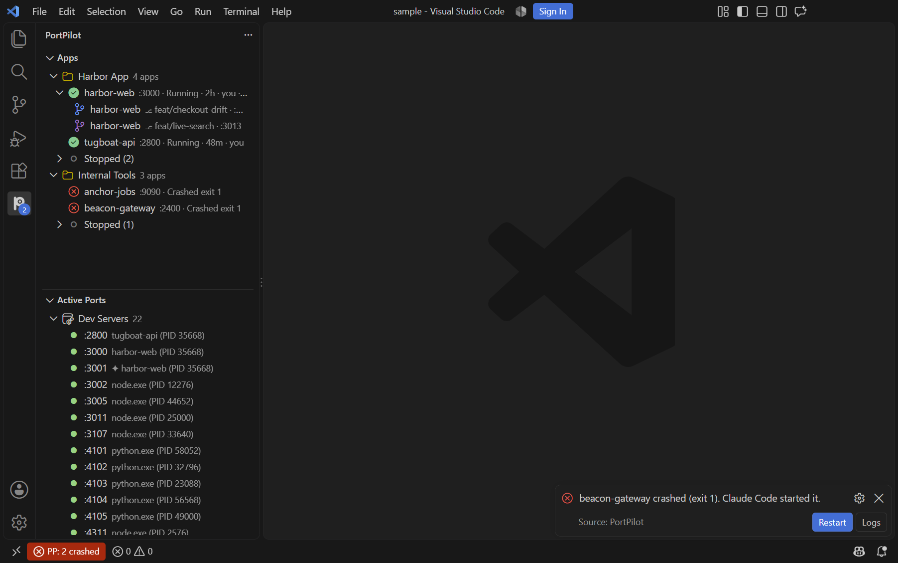

- **Web portal.** The classic Apps view in your browser, from `npm run agent` or from VS Code. It binds `127.0.0.1` only and needs a per-session token. Use it on a machine where you cannot install the desktop app. The new screens, row previews and crash toasts are not in the portal yet.
- **Tray.** A tray menu with a Stop per running app keeps your servers alive after you close the window.

## Everything else it does

- Start and stop apps with port detection and fallback ranges; groups, favourites and search
- Keep an app's port reserved while it is stopped
- Share an app's LAN URL to your phone by QR code
- Crash toast with an **Ask Claude** button when the session that started the app is still open

## MCP tools

<details id="mcp-tools">
<summary><b>MCP tools (26)</b></summary>

| Tool | Description |
|------|-------------|
| `list_apps` | List all registered apps with running status inline |
| `get_app` | Get details of a specific app |
| `get_status` | Get overall PortPilot status summary |
| `start_app` | Start an app by name or ID |
| `stop_app` | Stop a running app |
| `bulk_start` | Start multiple apps at once |
| `bulk_stop` | Stop multiple apps at once |
| `add_app` | Register a new app |
| `add_worktree` | Register a git worktree/branch nested under its parent project (auto-detects branch + parent from git) |
| `update_app` | Update app configuration |
| `delete_app` | Remove an app |
| `list_running` | Show currently running apps |
| `scan_ports` | Scan for active ports |
| `check_port` | Check what is running on a specific port |
| `kill_port` | Kill process on a port |
| `toggle_favorite` | Star/unstar an app |
| `delete_all_apps` | Remove all apps (requires confirmation) |
| `list_groups` | List all app groups |
| `move_to_group` | Move an app to a different group |
| `find_run` | Find a past run by text, app, branch or time; returns its git state and literal re-run steps |
| `list_browser_profiles` | List the named browser profiles: port, `cdpUrl`, state, `purpose`, `sites`, saved `window`, who is using each, open tabs, `free` and `leasedTo`. `for` (a site, URL or task) returns only the profiles that fit, best first, each with a `match.reason` |
| `list_browsers` | List the Chromium-family browsers installed here |
| `start_browser` | Start the profile for a site or task and get its port and `cdpUrl`; the caller never picks a port. `for` (free text or a URL) resolves by the profile's sites, name and purpose: `NO_MATCH` when none fits, `AMBIGUOUS` when several do (neither starts anything). `name` starts an exact profile. `name: "any"` is a throwaway browser with no logins, never for a task tied to a site. A profile another live session is using is refused (`IN_USE`); `takeover:true` overrides after telling the user |
| `stop_browser` | Stop a profile PortPilot started; never touches a process the profile did not start, and refuses one another live session is using unless `takeover:true` |
| `set_browser_mode` | Set a profile's mode for its next start: headed, offscreen or headless |
| `browser_history` | Past browser sessions, newest first: who started and ended each, when, and the pages (URL and title) that were open. Filters `profile`, `since`, `limit` (default 10, at most 50) |

**Browser tools without MCP.** The web agent (`npm run agent`) serves the same six tools as `POST /api/browser/<tool>` with the arguments as a JSON body and the `X-PortPilot-Token` header (the token is in `agent.json` beside the config). The answer is the same JSON the MCP tool returns: `{ success: true, name, port, cdpUrl, state, ... }`, or `{ success: false, code, error, action }`. Who started a profile is shown as a `claim`. A caller that names its session (`sessionId`) is held to the lease described below; a caller with no `sessionId` is never refused.

**Purpose, sites and routing.** A profile may carry `purpose` (a short phrase, at most 200 characters) and `sites` (hostnames such as `search.google.com`, at most 20, lowercase, no scheme or path). `for` is scored against them: a site match (the host, or a subdomain of a listed site) is the strongest signal, then the words of the purpose, the profile name, the note and the start URL's host. Only the profile's own words count: PortPilot knows nothing about any site, so write `gsc` into the purpose if you want to say "gsc". If the best two scores are within 25% of each other the answer is `AMBIGUOUS` with both names. At the start of every Claude Code conversation the plugin adds a short note listing the profiles (name, port, mode, purpose, sites; at most 25 profiles and 2 KB, never a folder path, a URL query or a long note), so Claude already knows to call `start_browser` with `for`. Nothing is added when you have no profiles.

**Window placement and keep in front.** Edit a profile and open **Window**: left, top, width, height and **Keep in front**. **Capture current position** reads the running browser's real window and fills the fields, so you place it by hand once. When a headed profile starts, PortPilot sets those bounds (Chrome DevTools Protocol `Browser.setWindowBounds`), reads them back, and reports `window: { requested, actual, applied }` in the start result. **Keep in front** also raises the page (`Page.bringToFront`) after the start and on every `start_browser` that reuses the running browser (which also puts the window back where it was saved), and, on Windows only and as best effort, makes the window always-on-top (`SetWindowPos` with `HWND_TOPMOST`; a failure is logged and reported as `topmost: false`, never an error). Other systems get the position, size and bring-to-front only. Offscreen and headless profiles ignore the window. Duplicate does not copy purpose, sites or window, so two profiles never both claim one site.

**Browser sessions and leases.** A profile started by Claude session A is leased to A while A's heartbeat (`sessions/<id>.json`, written every 15 s by the plugin) is under 45 s old. Session B then gets `{ success: false, code: "IN_USE", error, action }` naming the owner (short id) and when it started; `list_browser_profiles` shows `leasedTo` and `free` on every row, and `start_browser` with `name: "any"` (or no name and `free: true`) starts a free profile, or returns the one the session already holds. `takeover:true` overrides, for `start_browser` and `stop_browser`, and should follow telling the user. A lease whose owner has gone quiet is free again. Every start and stop is also kept in `history/browser-runs.json` (500 entries by default) with the tabs that were open, sampled about every 30 s and again at stop. Addresses are stored with secrets hidden: userinfo is dropped and the value of any query or fragment parameter that looks like a secret (token, key, code, auth, session, password) becomes `***`.

Manual setup for Claude Code without the plugin:

```bash
cd mcp-server && npm install && cd ..
claude mcp add portpilot -- node "/path/to/PortPilot/mcp-server/index.js"
claude mcp list   # portpilot: ... - ✓ Connected
```

</details>

## Install

| Platform | Download |
|----------|----------|
| Windows installer | [PortPilot-5.0.0-x64.exe](https://github.com/m4cd4r4/PortPilot/releases/download/v5.0.0/PortPilot-5.0.0-x64.exe) (113 MB) |
| Windows portable | [PortPilot-5.0.0-portable.exe](https://github.com/m4cd4r4/PortPilot/releases/download/v5.0.0/PortPilot-5.0.0-portable.exe) (113 MB) |
| Linux AppImage | [PortPilot-5.0.0-x86_64.AppImage](https://github.com/m4cd4r4/PortPilot/releases/download/v5.0.0/PortPilot-5.0.0-x86_64.AppImage) (123 MB) |
| Debian / Ubuntu | [PortPilot-5.0.0-amd64.deb](https://github.com/m4cd4r4/PortPilot/releases/download/v5.0.0/PortPilot-5.0.0-amd64.deb) (86 MB) |

macOS: build from source; it is supported but not officially tested. Install it, click Scan, then add your projects. Older builds are on [Releases](https://github.com/m4cd4r4/PortPilot/releases).

```bash
git clone https://github.com/m4cd4r4/PortPilot.git
cd PortPilot
npm install
npm start
```

## Reference

<details>
<summary><b>Adding apps and handling conflicts</b></summary>

**Auto-detect (recommended).** Click Add app, then **Browse**, and pick the project folder. PortPilot fills in the name from `package.json`, the command with the right package manager (`pnpm run dev`, `yarn dev`, `npm run dev`), the working directory and the preferred port from config files. Review, then Save.

**Manual entry.** Click Add app and fill in Name, Command (for example `npm run dev`), Working Directory, Preferred Port, and an optional Fallback Range (for example `3001-3010`).

**Port conflicts.** When another process holds an app's port, a banner flags it and its Fix button opens Ports, where **Free :port** stops the holder.

</details>

<details>
<summary><b>Badges</b></summary>

| Badge | Meaning | Detected when |
|-------|---------|---------------|
| 🐳 | Docker app | Command includes `docker` or `compose` |
| 📦 | Node.js app | Command includes `npm`, `npx`, `pnpm`, `yarn`, or `bun` |
| 🐍 | Python app | Command includes `python`, `uvicorn`, `flask`, or `django` |
| 🗄️ | Database | Command includes `postgres`, `mysql`, `redis`, or `mongo` |
| ⚡ | Auto-start | App configured to start on launch |
| 🌐 | Remote | App runs on a remote server/VPS |

A pulsing yellow 🐳 means Docker Desktop is not running (click to start it); green means it is ready. Running apps show `v4` or `v6` for the IP protocol they are bound to, so the browser button opens the right URL.

</details>

<details>
<summary><b>Keyboard shortcuts</b></summary>

| Shortcut | Action |
|----------|--------|
| `Ctrl+K` | Command palette (search apps, ports and profiles, then run an action) |
| `Escape` | Close the palette, a drawer or a menu |


</details>

<details>
<summary><b>Config file and example</b></summary>

- **Windows**: `%APPDATA%/portpilot/portpilot-config.json`
- **macOS**: `~/Library/Application Support/portpilot/portpilot-config.json`
- **Linux**: `~/.config/portpilot/portpilot-config.json`

```json
{
  "apps": [
    {
      "id": "app_harbor_web",
      "name": "harbor-web",
      "command": "npm run dev",
      "cwd": "/home/me/dev/harbor-web",
      "preferredPort": 3000,
      "fallbackRange": [3001, 3010],
      "color": "#84CC16",
      "autoStart": false
    }
  ],
  "settings": {
    "autoScan": true,
    "scanInterval": 5000,
    "openDevTools": false
  }
}
```

</details>

<details id="web-agent">
<summary><b>Web agent (preview)</b></summary>

PortPilot can run as a local web app: the same UI in your browser, backed by a hardened loopback agent.

```bash
npm run agent
# http://127.0.0.1:7317/
```

Because the backend can start and kill processes, it is locked down:

- Binds to **`127.0.0.1` only**
- A **per-session token** on every API call
- **Host-header** validation (defeats DNS rebinding) and **Origin/CORS** lockdown
- A custom header forces a **CORS preflight**, blocking cross-site requests
- Strict **CSP**; token file written `chmod 600`

Full threat model: [SECURITY.md](SECURITY.md). Run either the desktop app or the agent, not both at once: they track started processes separately.

</details>

<details>
<summary><b>Development and testing</b></summary>

```bash
npm install
npm start                    # run the app
npm run dev                  # dev mode (DevTools if enabled)
npm test                     # Playwright E2E smoke suite (Electron + test servers on 3000/3001/8080)
xvfb-run -a npm test         # headless Linux
npm run screenshots          # UI screenshots
npm run build                # Windows (NSIS installer)
npm run build:ui             # rebuild the React interface (the build scripts do this first)
npm run build:linux          # Linux (AppImage + .deb)
npm run build:all-platforms  # both
```

The smoke suite covers window launch, port scanning, test-server detection, port-card rendering, global search, copy/kill controls, the Settings panel and the Add App modal. The older `v1.3`/`v1.7`/`groups` specs target the pre-2.0 tab UI and are kept for reference only.

Launching from VS Code or Claude Code: `launch.js` clears `ELECTRON_RUN_AS_NODE` for you.

**Stack:** Electron, Node.js, a React and Vite interface (`ui/`), CSS variables for themes, Playwright for tests, `netstat` (Windows) / `lsof` (macOS, Linux) for port scanning.

</details>

## Releases

What changed in each version: [CHANGELOG.md](CHANGELOG.md) and [GitHub Releases](https://github.com/m4cd4r4/PortPilot/releases).

## Contributing

Pull requests are welcome. Bugs and ideas: [open an issue](https://github.com/m4cd4r4/PortPilot/issues).

## Licence

MIT © Macdara
