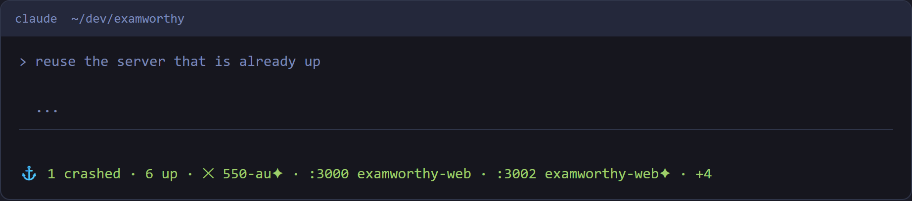
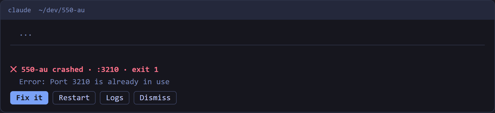
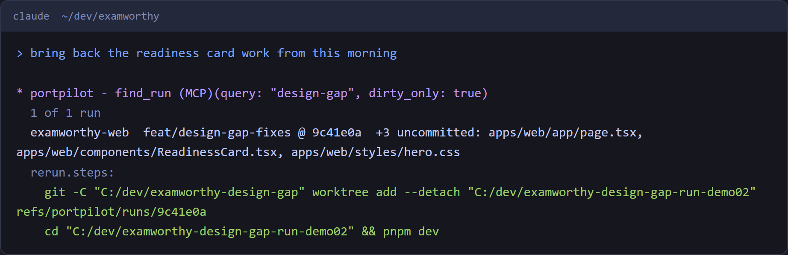

# PortPilot reference

Everything the [README](../README.md) leaves out: the MCP tools, browser-profile rules, config, badges, shortcuts, the web agent and how to build and test.

<a id="mcp-tools"></a>

## MCP tools (26)

| Tool | Description |
|------|-------------|
| `list_apps` | List all registered apps with running status inline |
| `get_app` | Get details of a specific app |
| `get_status` | Get overall PortPilot status summary |
| `start_app` | Start an app by name or ID |
| `stop_app` | Stop a running app |
| `bulk_start` | Start multiple apps at once |
| `bulk_stop` | Stop multiple apps at once |
| `add_app` | Register a new app |
| `add_worktree` | Register a git worktree/branch nested under its parent project (auto-detects branch + parent from git) |
| `update_app` | Update app configuration |
| `delete_app` | Remove an app |
| `list_running` | Show currently running apps |
| `scan_ports` | Scan for active ports |
| `check_port` | Check what is running on a specific port |
| `kill_port` | Kill process on a port |
| `toggle_favorite` | Star/unstar an app |
| `delete_all_apps` | Remove all apps (requires confirmation) |
| `list_groups` | List all app groups |
| `move_to_group` | Move an app to a different group |
| `find_run` | Find a past run by text, app, branch or time; returns its git state and literal re-run steps |
| `list_browser_profiles` | List the named browser profiles: port, `cdpUrl`, state, `purpose`, `sites`, saved `window`, who is using each, open tabs, `free` and `leasedTo`. `for` (a site, URL or task) returns only the profiles that fit, best first, each with a `match.reason` |
| `list_browsers` | List the Chromium-family browsers installed here |
| `start_browser` | Start the profile for a site or task and get its port and `cdpUrl`; the caller never picks a port. `for` (free text or a URL) resolves by the profile's sites, name and purpose: `NO_MATCH` when none fits, `AMBIGUOUS` when several do (neither starts anything). `name` starts an exact profile. `name: "any"` is a throwaway browser with no logins, never for a task tied to a site. A profile another live session is using is refused (`IN_USE`); `takeover:true` overrides after telling the user |
| `stop_browser` | Stop a profile PortPilot started; never touches a process the profile did not start, and refuses one another live session is using unless `takeover:true` |
| `set_browser_mode` | Set a profile's mode for its next start: headed, offscreen or headless |
| `browser_history` | Past browser sessions, newest first: who started and ended each, when, and the pages (URL and title) that were open. Filters `profile`, `since`, `limit` (default 10, at most 50) |

**Browser tools without MCP.** The web agent (`npm run agent`) serves the same six tools as `POST /api/browser/<tool>` with the arguments as a JSON body and the `X-PortPilot-Token` header (the token is in `agent.json` beside the config). The answer is the same JSON the MCP tool returns: `{ success: true, name, port, cdpUrl, state, ... }`, or `{ success: false, code, error, action }`. Who started a profile is shown as a `claim`. A caller that names its session (`sessionId`) is held to the lease described below; a caller with no `sessionId` is never refused.

**Purpose, sites and routing.** A profile may carry `purpose` (a short phrase, at most 200 characters) and `sites` (hostnames such as `search.google.com`, at most 20, lowercase, no scheme or path). `for` is scored against them: a site match (the host, or a subdomain of a listed site) is the strongest signal, then the words of the purpose, the profile name, the note and the start URL's host. Only the profile's own words count: PortPilot knows nothing about any site, so write `gsc` into the purpose if you want to say "gsc". If the best two scores are within 25% of each other the answer is `AMBIGUOUS` with both names. At the start of every Claude Code conversation the plugin adds a short note listing the profiles (name, port, mode, purpose, sites; at most 25 profiles and 2 KB, never a folder path, a URL query or a long note), so Claude already knows to call `start_browser` with `for`. Nothing is added when you have no profiles.

**Window placement and keep in front.** Edit a profile and open **Window**: left, top, width, height and **Keep in front**. **Capture current position** reads the running browser's real window and fills the fields, so you place it by hand once. When a headed profile starts, PortPilot sets those bounds (Chrome DevTools Protocol `Browser.setWindowBounds`), reads them back, and reports `window: { requested, actual, applied }` in the start result. **Keep in front** also raises the page (`Page.bringToFront`) after the start and on every `start_browser` that reuses the running browser (which also puts the window back where it was saved), and, on Windows only and as best effort, makes the window always-on-top (`SetWindowPos` with `HWND_TOPMOST`; a failure is logged and reported as `topmost: false`, never an error). Other systems get the position, size and bring-to-front only. Offscreen and headless profiles ignore the window. Duplicate does not copy purpose, sites or window, so two profiles never both claim one site.

**Browser sessions and leases.** A profile started by Claude session A is leased to A while A's heartbeat (`sessions/<id>.json`, written every 15 s by the plugin) is under 45 s old. Session B then gets `{ success: false, code: "IN_USE", error, action }` naming the owner (short id) and when it started; `list_browser_profiles` shows `leasedTo` and `free` on every row, and `start_browser` with `name: "any"` (or no name and `free: true`) starts a free profile, or returns the one the session already holds. `takeover:true` overrides, for `start_browser` and `stop_browser`, and should follow telling the user. A lease whose owner has gone quiet is free again. Every start and stop is also kept in `history/browser-runs.json` (500 entries by default) with the tabs that were open, sampled about every 30 s and again at stop. Addresses are stored with secrets hidden: userinfo is dropped and the value of any query or fragment parameter that looks like a secret (token, key, code, auth, session, password) becomes `***`.

Manual setup for Claude Code without the plugin:

```bash
cd mcp-server && npm install && cd ..
claude mcp add portpilot -- node "/path/to/PortPilot/mcp-server/index.js"
claude mcp list   # portpilot: ... - ✓ Connected
```


## Browser profiles in detail

- **Browser history.** Each profile's past sessions: who started and stopped each, when, and the pages that were open, with secrets in addresses hidden. **Open again** starts the profile and opens those pages (http and https only, at most 20).
- **Purpose, sites, window placement and leases** are described under [MCP tools](#mcp-tools) above, since that is where Claude uses them.

## More Claude Code views

Status line, worst state first, ✦ on apps Claude started:



Crash band with Fix it, Restart, Logs and Dismiss:



`find_run` bringing back a past version of a page, with the literal steps:



The Claude Code images are terminal frames rendered around the plugin's real output on the demo data, not captures of the Claude Code app.

## Also in the app

- Start and stop apps with port detection and fallback ranges; groups, favourites and search
- Keep an app's port reserved while it is stopped
- Share an app's LAN URL to your phone by QR code
- Crash toast with an **Ask Claude** button when the session that started the app is still open

## Adding apps and handling conflicts

**Auto-detect (recommended).** Click Add app, then **Browse**, and pick the project folder. PortPilot fills in the name from `package.json`, the command with the right package manager (`pnpm run dev`, `yarn dev`, `npm run dev`), the working directory and the preferred port from config files. Review, then Save.

**Manual entry.** Click Add app and fill in Name, Command (for example `npm run dev`), Working Directory, Preferred Port, and an optional Fallback Range (for example `3001-3010`).

**Port conflicts.** When another process holds an app's port, the Alerts bell counts it, and its Fix button opens Ports, where **Free :port** stops the holder.

## Badges

| Badge | Meaning | Detected when |
|-------|---------|---------------|
| 🐳 | Docker app | Command includes `docker` or `compose` |
| 📦 | Node.js app | Command includes `npm`, `npx`, `pnpm`, `yarn`, or `bun` |
| 🐍 | Python app | Command includes `python`, `uvicorn`, `flask`, or `django` |
| 🗄️ | Database | Command includes `postgres`, `mysql`, `redis`, or `mongo` |
| ⚡ | Auto-start | App configured to start on launch |
| 🌐 | Remote | App runs on a remote server/VPS |

A pulsing yellow 🐳 means Docker Desktop is not running (click to start it); green means it is ready. Running apps show `v4` or `v6` for the IP protocol they are bound to, so the browser button opens the right URL.

## Keyboard shortcuts

| Shortcut | Action |
|----------|--------|
| `Ctrl+K` | Command palette (search apps, ports and profiles, then run an action) |
| `Escape` | Close the palette, a drawer or a menu |

## Config file and example

- **Windows**: `%APPDATA%/portpilot/portpilot-config.json`
- **macOS**: `~/Library/Application Support/portpilot/portpilot-config.json`
- **Linux**: `~/.config/portpilot/portpilot-config.json`

```json
{
  "apps": [
    {
      "id": "app_harbor_web",
      "name": "harbor-web",
      "command": "npm run dev",
      "cwd": "/home/me/dev/harbor-web",
      "preferredPort": 3000,
      "fallbackRange": [3001, 3010],
      "color": "#84CC16",
      "autoStart": false
    }
  ],
  "settings": {
    "autoScan": true,
    "scanInterval": 5000,
    "openDevTools": false
  }
}
```

## Web agent (preview)

PortPilot can run as a local web app: the same UI in your browser, backed by a hardened loopback agent.

```bash
npm run agent
# http://127.0.0.1:7317/
```

Because the backend can start and kill processes, it is locked down:

- Binds to **`127.0.0.1` only**
- A **per-session token** on every API call
- **Host-header** validation (defeats DNS rebinding) and **Origin/CORS** lockdown
- A custom header forces a **CORS preflight**, blocking cross-site requests
- Strict **CSP**; token file written `chmod 600`

Full threat model: [SECURITY.md](../SECURITY.md). Run either the desktop app or the agent, not both at once: they track started processes separately.

## Development and testing

```bash
npm install
npm start                    # run the app
npm run dev                  # dev mode (DevTools if enabled)
npm test                     # unit tests, then the redesign E2E specs (Electron)
npm run test:unit            # unit tests only (what CI runs, with test:mcp)
npm run test:mcp             # MCP server tests
npm run test:journeys        # user journeys: multi-day scripts across app relaunches
xvfb-run -a npm test         # headless Linux
npm run screenshots          # UI screenshots
npm run build                # Windows (NSIS installer)
npm run build:ui             # rebuild the React interface (the build scripts do this first)
npm run build:linux          # Linux (AppImage + .deb)
npm run build:all-platforms  # both
```

The E2E specs (`tests/redesign-*.e2e.js`) each open one screen against a fresh config. The journeys (`tests/journeys/`) keep one config folder across several launches and play a script of events: servers start and crash, a stranger takes a port, two Claude sessions share a browser over MCP, PortPilot quits and comes back. Every step is checked from outside the app (files on disk, ports, Brave's debug port, the rendered screen), never by the app's own word. Run journeys one at a time; they use real ports. The plan, every finding (F-numbers) and every run are in [docs/testing/](testing/).

Launching from VS Code or Claude Code: `launch.js` clears `ELECTRON_RUN_AS_NODE` for you.

**Stack:** Electron, Node.js, a React and Vite interface (`ui/`), CSS variables for themes, Playwright for tests, `netstat` (Windows) / `lsof` (macOS, Linux) for port scanning.
