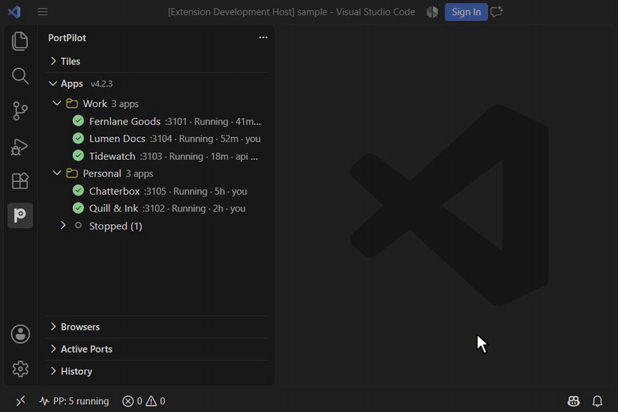
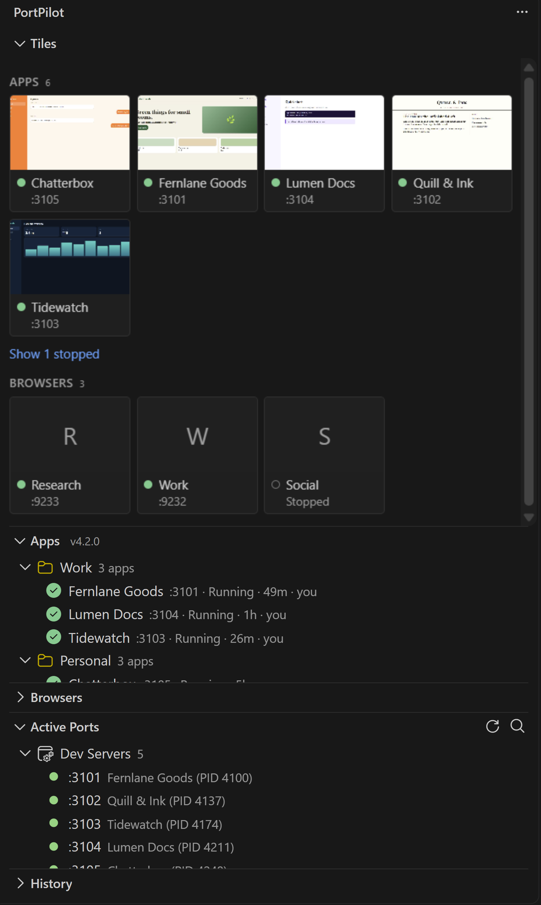
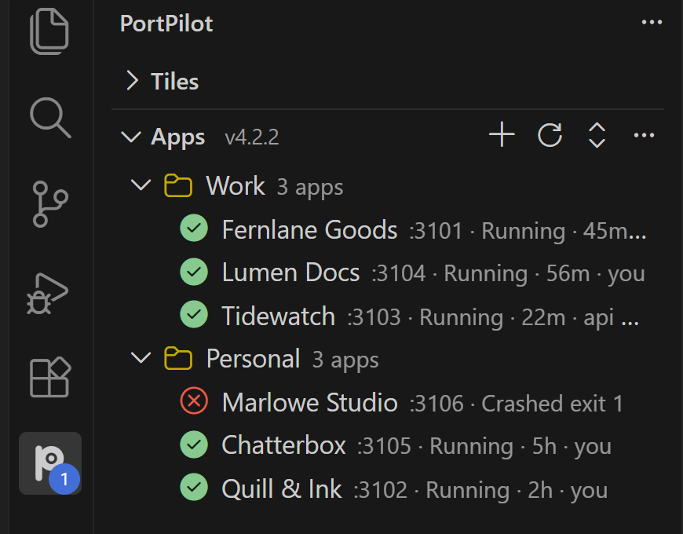
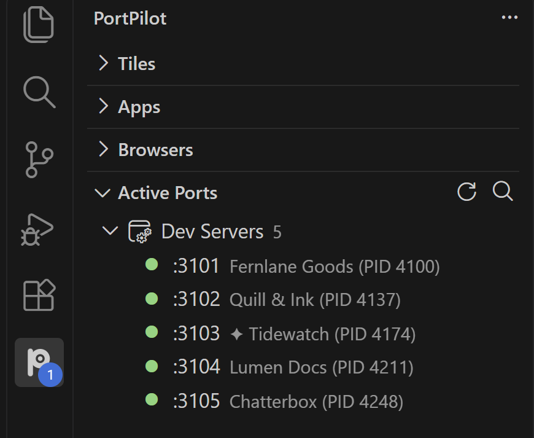
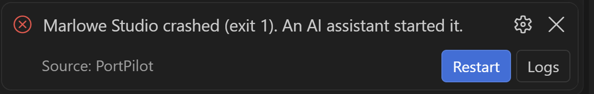
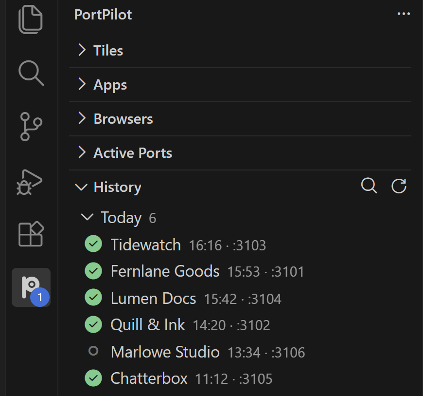
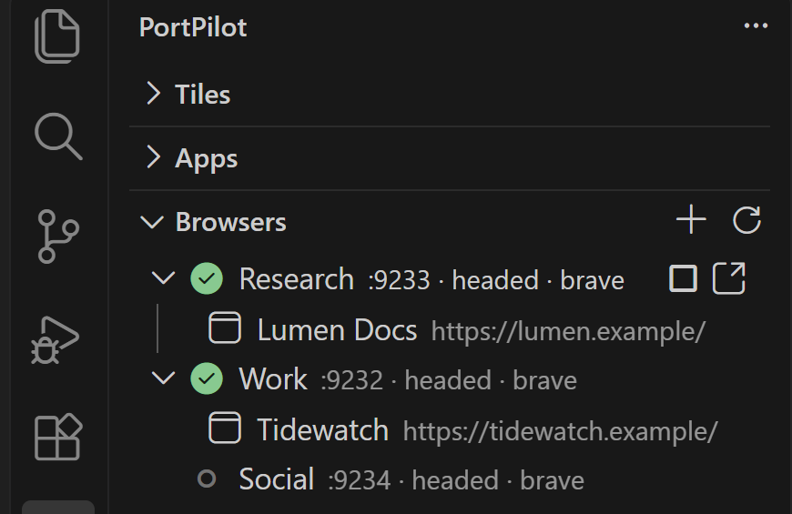

# PortPilot for VS Code

**Every dev server and port in your sidebar, with crash alerts and the servers your AI assistant started marked.**

PortPilot lists your registered apps and every listening port in the VS Code sidebar. Running apps come first, crashes get a badge and a toast, and a ✦ marks anything an AI assistant started through PortPilot. It shares one config with the [PortPilot desktop app](https://github.com/m4cd4r4/PortPilot) and its MCP server, so the editor, the desktop app and Claude all see the same state.



## What's in the sidebar

**Tiles, at the top.** The `Tiles` view shows your apps and dedicated browsers as small picture tiles. Running apps and ones that need attention come first, each with the page picture the desktop app took (the last known one while a fresh run has none, and a letter tile when an app has never had one); idle apps fold into a compact `Show N stopped` list. Below that, one tile per browser profile with the site's icon the desktop app saved for it. Click a running app's tile to open it, click a running browser's tile to bring its page to the front, and hover a tile for Start or Stop. The pictures are read from PortPilot's local files and never leave your machine.



Turn the view off with `portpilot.tilesView`; the Apps and Browsers lists below it start collapsed on a new install.

**Apps, running first.** Each app shows its port, its state, how long it has been in that state and who started it: you, or a Claude Code session. Stopped apps fold into a collapsed `Stopped (N)` node at the end of each group, so the running ones stay on screen. Worktree branches sit under their app.



**Ports that name their app.** Active Ports shows the app that owns each port where PortPilot knows it, and the process and PID where it does not. A ✦ marks a server Claude Code started.



**Crash alerts.** When an app crashes, the PortPilot icon gets a count badge and a toast says which app crashed, its exit code and whether an AI assistant started it. Restart brings it back; Logs opens its output with the stderr tail. A crash from before the window opened shows in the badge without a toast. The status bar switches from `PP: 5 running` to `PP: Marlowe Studio crashed`.



**History: reopen a page from a past run.** The `History` view lists past localhost pages, newest first, grouped by day. Each row shows the app, start time and port. Hover for the page title, URL, git branch and thumbnail.



Click a running page to open it, or a closed one to start it again (PortPilot waits for the port before opening). Pin keeps a run from being pruned; search filters the newest 200. Everything is read from local files and never leaves your machine.

**Browsers: manage your debug-port browsers without leaving the editor.** The `Browsers` view lists the named browser profiles from the PortPilot app's Browsers tab (or created by Claude with `start_browser`): one row each with `:port · mode · browser`, running first, then port held, then stopped. A running profile expands to its open tabs (title and URL, the first 30). Hover for the note, start URL, profile folder and, when a Claude session has leased the profile, who has it.



Row buttons start, stop, set the mode of, and open a URL in a profile, or copy its CDP URL. Click a tab to bring it to the front. Stop only ends a browser PortPilot started. The view reads tab titles and URLs from each profile's own debug port on `127.0.0.1`, every 10 seconds while it is on screen, never page content.

**Browser Previews, off until you ask.** Right-click a profile and choose Show Preview for a small picture of its front page. Off by default because a picture can show a signed-in page; pictures stay in memory and are never saved or sent.

## Web portal, hosted from VS Code

Turn on `portpilot.webPortal.enabled` and PortPilot runs its full browser UI from VS Code, with no desktop app needed. A `PP Portal` item appears in the status bar; click it to open `http://127.0.0.1:<port>/`.

The portal binds `127.0.0.1` only and needs a per-session token. It runs on the editor's own Node, shuts down cleanly on Windows, and exits if the editor closes. Threat model: [SECURITY.md](https://github.com/m4cd4r4/PortPilot/blob/master/SECURITY.md).

## Use it with Claude Code

The ✦ marks and the "An AI assistant started it" line appear for any app an MCP assistant started through PortPilot. The PortPilot plugin for Claude Code adds the same view inside Claude: a status line, a guard that reuses a running server instead of starting a second copy, and a crash band with Fix it.

```text
/plugin marketplace add m4cd4r4/PortPilot
/plugin install portpilot@portpilot
```

## Settings

| Setting | Default | Description |
|---------|---------|-------------|
| `portpilot.foldStoppedApps` | `true` | Sort running and crashed apps first and fold stopped apps into a `Stopped (N)` node. |
| `portpilot.tilesView` | `true` | Show the Tiles view at the top of the sidebar. |
| `portpilot.rowPreviews` | `true` | Show a page preview when you hover a running app, and on its tile in the Tiles view. |
| `portpilot.webPortal.enabled` | `false` | Run the web portal whenever this window is open. |
| `portpilot.webPortal.stopAppsOnStop` | `false` | Also stop the dev servers the portal started when it stops. |

Every action is in the Command Palette under `PortPilot:` and on the sidebar.

## Links

- [GitHub repository](https://github.com/m4cd4r4/PortPilot)
- [Desktop app downloads](https://github.com/m4cd4r4/PortPilot/releases/latest)
- [Website](https://m4cd4r4.github.io/PortPilot/)

MIT licensed.
